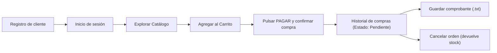

# Belle Store — Manual de Usuario

**Sistema:** Belle Store (Tienda de moda en aplicación de escritorio)  
**Documento:** Manual de Usuario  
**Versión:** 1.0  
**Año:** 2026  
**Autores:** Daisy Sánchez y Moisés Fabra  

> **Nota:** Este manual describe paso a paso el funcionamiento completo de **Belle Store** para los roles de **Cliente** y **Administrador**. Está redactado en lenguaje claro para cualquier usuario, sin requerir conocimientos técnicos.

## Índice

- **1. Introducción**
  - Qué es Belle Store
  - A quién va dirigido este manual
  - Qué puedes hacer según tu rol
- **2. Requisitos e inicio del programa**
  - Requisitos del equipo
  - Cómo abrir la aplicación
  - Datos iniciales de demostración y títulos de ventana
- **3. Acceso al sistema**
  - Inicio de sesión
  - Registro de un nuevo cliente
- **4. Guía del Cliente**
  - La cabecera del cliente
  - Catálogo de productos
  - Lista de Deseados
  - Carrito de Compras
  - Pagar una compra
  - Historial de compras
  - Mi perfil
  - Cerrar sesión
- **5. Guía del Administrador**
  - Visión general del panel administrativo
  - Gestión de Productos
  - Gestión de Órdenes
  - Cerrar sesión
- **6. Reglas del negocio**
  - Impuestos (IVA), envío y totales
  - Ejemplos numéricos de cálculo
  - Inventario, estados y persistencia
  - Flujo completo de una compra
- **7. Preguntas frecuentes y solución de problemas**
- **8. Anexos**
  - Anexo A: Credenciales y datos de demostración
  - Anexo B: Dónde se guardan los datos
  - Anexo C: Glosario

## 1. Introducción

### Qué es Belle Store

**Belle Store** es una aplicación de escritorio de comercio electrónico de moda desarrollada como proyecto académico de Programación II. Permite explorar un catálogo de prendas y accesorios, administrar una lista de productos deseados, armar un carrito de compras, confirmar pedidos con cálculo automático de envío e impuestos (en pesos colombianos, por ejemplo `$200.000 COP`) y consultar el historial de compras con generación de comprobantes en archivo de texto.

La aplicación presenta un diseño visual minimalista con bordes rectos y una cabecera gris acompañada de una franja oscura inferior. Toda la información se almacena en archivos locales dentro del propio equipo, por lo que no requiere conexión a internet ni una base de datos externa para operar.

### A quién va dirigido este manual

Este documento está dirigido a cualquier persona que utilice **Belle Store**, tanto clientes que desean consultar el catálogo y realizar compras como administradores encargados de mantener actualizado el inventario de productos y dar seguimiento a las órdenes registradas.

### Qué puedes hacer según tu rol

Belle Store cuenta con dos roles de acceso independientes. Cada rol dispone de sus propias pantallas y opciones:

| Rol | Qué puedes hacer en la aplicación |
| :--- | :--- |
| **Cliente** | Registrarse con una cuenta nueva, iniciar sesión, explorar el catálogo de productos, buscar y filtrar por categoría o sexo, guardar productos en la **Lista de Deseados**, agregar unidades al **Carrito de Compras**, revisar el cálculo de envío e IVA, confirmar el pago de una orden, guardar comprobantes en `.txt`, consultar su **Historial de compras**, cancelar órdenes pendientes y actualizar su celular y dirección en **Mi perfil**. |
| **Administrador** | Iniciar sesión en el panel administrativo, consultar las tablas de **PRODUCTOS** y **ORDENES**, buscar y filtrar registros, ordenar columnas, añadir nuevos productos con imagen, editar productos existentes, eliminar productos sin órdenes asociadas, actualizar el estado y la dirección de las órdenes y eliminar órdenes cuando sea necesario. |

> **Importante:** Por seguridad y organización del sistema, cada usuario solo puede abrir las pantallas correspondientes a su propio rol.

## 2. Requisitos e inicio del programa

### Requisitos del equipo

Para ejecutar **Belle Store** correctamente en tu computador necesitas cumplir con las siguientes condiciones:

- **Sistema operativo:** Equipo con Windows (o Linux).
- **Entorno necesario:** Tener **Java** instalado en el equipo (y NetBeans o Maven para ejecutar el proyecto).
- **Resolución de pantalla:** La aplicación abre por defecto una ventana de **1280 × 768** píxeles y admite un tamaño mínimo de **1024 × 680** píxeles.
- **Conexión:** No se requiere acceso a internet ni configuración de base de datos externa.

### Cómo abrir la aplicación

Puedes iniciar **Belle Store** de cualquiera de estas dos maneras:

**Opción A — Desde NetBeans:**

1. Abre el entorno NetBeans en tu computador.
2. Selecciona el proyecto de **Belle Store** en el panel de proyectos.
3. Haz clic en el botón o menú **Run Project**.
4. **Resultado esperado:** El programa compila si es necesario y abre la ventana principal en la pantalla **"Belle Store - Iniciar Sesión"**.

**Opción B — Desde la consola:**

1. Abre una ventana de terminal o consola en tu computador.
2. Ubícate dentro de la carpeta `belle_store_pkg` del proyecto.
3. Escribe el siguiente comando y pulsa **Enter**: `mvn javafx:run`
4. **Resultado esperado:** La aplicación arranca y muestra la ventana **"Belle Store - Iniciar Sesión"**.

### Datos iniciales de demostración y títulos de ventana

La primera vez que abres **Belle Store**, el sistema crea automáticamente un conjunto de datos de demostración que incluye las cuentas de prueba (un administrador y un cliente), cuatro productos iniciales y órdenes de ejemplo. De este modo puedes probar todas las funciones desde el primer momento.

A medida que navegas por la aplicación, la barra superior de la ventana cambia su título para indicarte en qué pantalla te encuentras:

| Pantalla | Título de la ventana |
| :--- | :--- |
| Inicio de sesión | `Belle Store - Iniciar Sesión` |
| Registro de cliente | `Belle Store - Registro` |
| Panel administrativo | `Belle Store - Administrador` |
| Catálogo de productos | `Belle Store - Catálogo` |
| Lista de deseados | `Belle Store - Lista de Deseados` |
| Carrito de compras | `Belle Store - Carrito de Compras` |
| Historial de compras | `Belle Store - Historial de Compras` |

## 3. Acceso al sistema

### Inicio de sesión

Al abrir la aplicación verás la pantalla de inicio de sesión dividida en dos mitades: una imagen editorial a un lado y el formulario de acceso al otro. En el formulario encontrarás los campos **Usuario / Correo Electrónico** (con el texto de ayuda *"Correo registrado o 'admin'"*) y **Clave**, además del botón **Ingresar** y el enlace **Registrarse**.

Sigue estos pasos para iniciar sesión:

1. Haz clic en el campo **Usuario / Correo Electrónico** (cuando abre la pantalla, el cursor ya se ubica automáticamente en este campo) y escribe tu correo electrónico registrado o la palabra `admin`.
2. Pulsa la tecla **Enter** (el cursor pasará automáticamente al campo **Clave**).
3. Escribe tu contraseña en el campo **Clave**.
4. Pulsa **Enter** o haz clic en el botón **Ingresar**.
5. **Resultado esperado:** Mientras el sistema verifica tus datos aparece el indicador *"Cargando..."* y los controles quedan temporalmente bloqueados para evitar envíos duplicados. Si los datos son correctos, aparece el mensaje *"¡Inicio exitoso! Redirigiendo..."* y el sistema abre la pantalla correspondiente a tu rol: el **Administrador** ingresa al panel **"Belle Store - Administrador"** y el **Cliente** ingresa directamente al **Catálogo** (**"Belle Store - Catálogo"**).

> **Importante:** Para iniciar sesión solo se acepta el **correo electrónico** registrado o la palabra `admin`. Ni tu número de identificación (cédula) ni tu nombre completo sirven como usuario de ingreso.

**Mensajes de error más comunes al iniciar sesión:**

- Si dejas alguno de los dos campos vacío y pulsas **Ingresar**, los campos vacíos se resaltan en rojo y aparece el mensaje: `"Por favor, ingresa tu usuario/correo y contraseña."`.
- Si el correo o la contraseña no coinciden con ninguna cuenta registrada, aparece el mensaje: `"Usuario o contraseña incorrectos. Verifica tus datos."`.

### Registro de un nuevo cliente

Si aún no tienes una cuenta de cliente, puedes crear una directamente desde la pantalla de inicio de sesión haciendo clic en el enlace **Registrarse**. Se abrirá una pantalla con una tarjeta gris centrada titulada **REGISTRO**, compuesta por siete campos obligatorios, el botón **REGISTRARSE** y el enlace inferior *"¿Ya tienes una cuenta? Inicia sesión"* para regresar cuando lo desees.

Antes de diligenciar el formulario, ten en cuenta las reglas de validación de cada campo:

| Campo | Regla que debe cumplir |
| :--- | :--- |
| **Nombre Completo** | Solo acepta letras, tildes, ñ y espacios (mínimo 3 letras). No permite escribir números ni símbolos. |
| **Número de Identificación** | Solo admite dígitos numéricos, entre 5 y 15 dígitos. Debe ser único en el sistema. |
| **Correo Electrónico** | Debe tener un formato de correo válido (por ejemplo, `nombre@correo.com`). Debe ser único en el sistema. |
| **Número de Celular** | Debe contener exactamente 10 dígitos numéricos. |
| **Dirección** | Texto libre para indicar tu dirección de entrega. |
| **Contraseña** | Debe tener como mínimo 4 caracteres. |
| **Confirmar Contraseña** | Debe coincidir exactamente con la contraseña escrita. Mientras escribes, el campo muestra un borde rojo si no coincide y un borde verde cuando coincide. |

Sigue estos pasos para crear tu cuenta de cliente:

1. En la pantalla de inicio de sesión, haz clic en el enlace **Registrarse**.
2. Completa cada uno de los siete campos del formulario **REGISTRO** respetando las reglas de la tabla anterior.
3. Verifica que los campos **Contraseña** y **Confirmar Contraseña** muestren el borde verde de coincidencia.
4. Haz clic en el botón **REGISTRARSE** (o pulsa **Enter**).
5. **Resultado esperado:** El sistema valida la información, muestra el mensaje verde *"¡Registro exitoso! Redirigiendo al inicio de sesión..."* y, aproximadamente 1,5 segundos después, te lleva de vuelta a la pantalla de inicio de sesión. Tu cuenta queda activa de inmediato (no requiere confirmación por correo electrónico) y ya puedes iniciar sesión con tu correo y contraseña.

**Mensajes de validación durante el registro:**

- Si dejas campos obligatorios vacíos al pulsar **REGISTRARSE**, cada campo faltante muestra borde rojo y etiqueta roja junto al mensaje: `"Por favor, completa los campos requeridos marcados en rojo."`. El resaltado rojo desaparece automáticamente en cuanto empiezas a escribir en el campo.
- Si las contraseñas no coinciden, aparece el mensaje: `"Las contraseñas no coinciden."`.
- Si el correo no cumple con el formato válido, aparece: `"El correo electrónico ingresado no tiene un formato válido."`.
- Si intentas usar un correo que ya existe, aparece: `"El correo electrónico ya se encuentra registrado."`.
- Si intentas usar una identificación que ya existe, aparece: `"El número de identificación ya se encuentra registrado."`.

## 4. Guía del Cliente

### La cabecera del cliente

Una vez inicias sesión como cliente, verás una barra superior fija llamada cabecera que te acompaña en las cuatro pantallas principales (**Catálogo**, **Lista de Deseados**, **Carrito de Compras** e **Historial de Compras**). Debajo de la cabecera se muestra una franja oscura decorativa.

De izquierda a derecha, la cabecera contiene los siguientes elementos:

| Elemento | Ubicación / Icono | Qué hace al pulsarlo |
| :--- | :--- | :--- |
| **Belle store** | Izquierda (nombre de la tienda) | Regresa al catálogo completo de productos. |
| **Hombre** | Parte izquierda | Abre el catálogo filtrado para mostrar productos de **HOMBRE** y **UNISEX**. |
| **Mujer** | Parte izquierda | Abre el catálogo filtrado para mostrar productos de **MUJER** y **UNISEX**. |
| **Accesorios** | Parte izquierda | Abre el catálogo filtrado por la categoría **ACCESORIOS**. |
| **Lupa** | Icono a la derecha | Muestra u oculta la barra de búsqueda del catálogo. |
| **Corazón** | Icono a la derecha | Abre la **Lista de Deseados**. Tiene una insignia numérica que indica cuántos productos distintos tienes guardados. |
| **Carrito** | Icono a la derecha | Abre el **Carrito de Compras**. Tiene una insignia numérica que indica el total de unidades que llevas en el carrito. |
| **Menú** | Icono de tres líneas a la derecha | Despliega un menú con cuatro opciones: **Catálogo de productos**, **Historial de compras**, **Mi perfil** y **Cerrar sesión**. |

### Catálogo de productos

El **Catálogo** es la pantalla principal del cliente. Muestra los productos organizados en una cuadrícula de tarjetas que se reacomoda automáticamente cuando cambias el tamaño de la ventana.

Cada tarjeta de producto incluye:
- Imagen del producto.
- Nombre del producto.
- Precio en pesos colombianos (ejemplo: `$200.000 COP`).
- Público objetivo o sexo (`HOMBRE`, `MUJER` o `UNISEX`).
- Cantidad de unidades disponibles (o el aviso `"Sin unidades"` si está agotado).
- Icono de **corazón** (vacío si no está en deseados; **rojo** si ya está guardado en tu lista).
- Botón **Añadir al carrito**.

**Cómo buscar y filtrar productos**

1. **Filtrar por categoría:** En el panel derecho verás las categorías **Todas**, **Camisas**, **Pantalones** y **Accesorios**. Haz clic en cualquiera de ellas para ver solo los productos de esa categoría.
2. **Filtrar por sexo:** En la barra rápida superior del catálogo puedes elegir **Todos**, **Hombre**, **Mujer** o **Unisex**.
3. **Buscar por texto:** Haz clic en el icono de la **Lupa** en la cabecera para desplegar el cuadro de búsqueda y escribe el nombre, la categoría, el ID o el sexo del producto. Los resultados se actualizan mientras escribes. Pulsa **Limpiar** para borrar el texto y ocultar la barra de búsqueda.
4. **Resultado esperado:** El catálogo muestra únicamente las tarjetas que coinciden con la categoría, el sexo y el texto buscado.

> **Nota:** Al elegir **Hombre** o **Mujer** (ya sea en la cabecera o en la barra rápida), el sistema también muestra los productos marcados como **Unisex**, ya que aplican para ambos públicos. Si deseas ver únicamente prendas o artículos unisex, pulsa el botón **Unisex** en la barra rápida del catálogo.

Si ningún producto cumple con tus filtros o búsqueda, verás el mensaje `"No encontramos productos que coincidan con tu búsqueda o categoría."` junto al botón **Ver todos los productos** para restaurar la vista completa.

**Cómo guardar en deseados o añadir al carrito desde el catálogo**

1. Para guardar o quitar un producto de tu lista de deseados, haz clic en el **corazón** ubicado en su tarjeta. El corazón cambiará a color **rojo** si fue añadido o volverá a mostrarse vacío si fue retirado, mostrando un mensaje temporal de confirmación en pantalla y actualizando la insignia del corazón en la cabecera.
2. Para agregar una unidad al carrito, haz clic en el botón **Añadir al carrito** de la tarjeta deseada.
3. **Resultado esperado:** Aparece el mensaje temporal `"<NOMBRE DEL PRODUCTO> añadido al carrito."` y el contador del carrito en la cabecera aumenta en 1. Si ya alcanzaste la cantidad máxima disponible en inventario para ese producto, el sistema no te dejará agregar más unidades y mostrará el mensaje `"Ya tienes el máximo disponible..."`.

**Productos agotados**

Cuando un producto tiene `0` unidades disponibles en inventario, su tarjeta muestra una insignia roja con la palabra **AGOTADO**, indica `"Sin unidades"` y su botón principal aparece deshabilitado con el texto **Agotado**, impidiendo añadirlo al carrito.

### Lista de Deseados

La **Lista de Deseados** reúne los productos que marcaste con el corazón para revisarlos más adelante o pasarlos al carrito en la cantidad que prefieras. Puedes acceder a ella haciendo clic en el icono del **Corazón** de la cabecera.

En la parte superior verás el banner **LISTA DE DESEADOS** y debajo aparecerán los productos en **tarjetas horizontales**. Cada tarjeta horizontal muestra:
- Imagen del producto.
- Nombre del producto.
- Estado (**DISPONIBLE** o **AGOTADO**).
- Precio unitario.
- Selector de cantidad **Cantidad [+] N [-]**.
- Icono de **corazón rojo** para quitar el producto de la lista.
- Icono de **carrito** para enviar al carrito la cantidad seleccionada.

Sigue estos pasos para gestionar tu lista de deseados:

1. Haz clic en el icono del **Corazón** en la cabecera para abrir **LISTA DE DESEADOS**.
2. Si deseas enviar un producto disponible al carrito, ajusta la cantidad con los botones **[+]** y **[-]** (el selector nunca te permitirá elegir más unidades que el stock disponible).
3. Haz clic en el icono de **carrito** dentro de esa misma tarjeta.
4. Si deseas retirar un producto de la lista, haz clic en el **corazón rojo** de la tarjeta.
5. **Resultado esperado:** Al pulsar el icono de carrito, las unidades elegidas se suman a tu carrito y sube la insignia del carrito en la cabecera. Al pulsar el corazón rojo, el producto desaparece de la lista y baja la insignia del corazón en la cabecera.

> **Nota:** Tu lista de deseados se guarda automáticamente por usuario y se conserva intacta aunque cierres sesión. Si un producto de tu lista se agota mientras tanto, su selector de cantidad y el botón del carrito aparecerán deshabilitados hasta que vuelva a tener unidades.

Si aún no has guardado ningún producto, verás el mensaje `"Aún no tienes productos en tu lista de deseados."` acompañado del botón **Explorar catálogo**.

### Carrito de Compras

Para revisar los productos que vas a comprar, haz clic en el icono del **Carrito** en la cabecera. Se abrirá la pantalla con el banner **CARRITO DE COMPRAS**, dividida en dos zonas: a la izquierda la lista de artículos seleccionados y a la derecha el panel **Resumen de la compra**.

En la zona izquierda encontrarás:
- Un resumen superior con el conteo de artículos y unidades (por ejemplo, `"1 producto(s) · 2 unidad(es)"`).
- El botón **Vaciar carrito** para eliminar todos los productos de una sola vez.
- Una tarjeta por cada producto con su imagen, nombre, precio unitario, selector **Cantidad [+] N [-]**, el texto `"Subtotal: ..."` calculado para ese producto y el botón **Quitar**.

En el panel derecho **Resumen de la compra** verás en tiempo real:
- **Subtotal:** suma del valor de todos los productos en el carrito.
- **Envío:** costo de envío según el subtotal.
- **Impuestos (IVA 19%):** cálculo del 19 % sobre el subtotal.
- **TOTAL:** suma final a pagar (Subtotal + Envío + Impuestos).
- Una nota informativa debajo que te indica cuánto te falta para alcanzar el envío gratis (o te confirma si ya aplicaste a él).

**Cómo modificar cantidades o vaciar el carrito**

1. Para aumentar o disminuir unidades de un producto, usa los botones **[+]** y **[-]** del selector **Cantidad**. Si bajas la cantidad a `0`, el producto se elimina automáticamente del carrito.
2. Para retirar un producto directamente, haz clic en **Quitar**.
3. Para retirar todos los productos, haz clic en **Vaciar carrito** y luego confirma pulsando **Vaciar** (o pulsa **Cancelar** si cambias de opinión).
4. **Resultado esperado:** Los totales del panel **Resumen de la compra** y la insignia numérica del carrito en la cabecera se actualizan de inmediato. Cuando el carrito queda vacío, aparece el mensaje `"Tu carrito de compras está vacío."` junto a los botones **Explorar catálogo** y **Ver lista de deseados**.

**Aviso de stock en vivo dentro del carrito**

Si mientras tenías productos guardados en el carrito el administrador redujo el inventario o vendió unidades a otro cliente, el carrito detecta la diferencia al instante y protege tu compra:

- Si ahora hay menos unidades disponibles de las que tenías seleccionadas, la tarjeta muestra un aviso en rojo: `"Stock disponible actual: N unidad(es)."` acompañado del botón **Ajustar a N** para corregir la cantidad con un clic.
- Si el producto se quedó sin unidades, la tarjeta muestra en rojo: `"Producto agotado actualmente. Retíralo para poder pagar."`.

> **Importante:** Mientras exista cualquier producto con problema de stock o agotado en el carrito, el botón **PAGAR** permanecerá deshabilitado hasta que ajustes o quites esos artículos.

### Pagar una compra

Cuando estés conforme con los productos y las cantidades de tu carrito, sigue estos pasos para completar la compra:

1. Haz clic en la franja inferior **PAGAR** dentro del **Carrito de Compras**.
2. Se abrirá el diálogo **Confirmar compra**. Revisa tus datos de cliente, verifica o edita el campo **Dirección de entrega** (viene precargado con tu dirección registrada y debe tener al menos 4 caracteres) y comprueba el desglose de **Subtotal**, **Envío**, **Impuestos** y **Total a pagar**.
3. Haz clic en **Confirmar compra** (o en **Cancelar** si deseas volver al carrito sin pagar).
4. **Resultado esperado:** Si la dirección es inválida, el diálogo permanece abierto y muestra un error en pantalla para que la corrijas. Si todo es correcto, el botón cambia temporalmente a `"PROCESANDO COMPRA..."` mientras se registra la orden.
5. Una vez confirmada, aparece el diálogo **¡Compra realizada!** indicando el número de orden generado, el total pagado y el estado inicial **Pendiente**, junto con el botón opcional **Guardar comprobante (.txt)** y el botón **Aceptar**.
6. Si lo deseas, pulsa **Guardar comprobante (.txt)** para descargar tu recibo o pulsa **Aceptar** para continuar. El sistema descuenta automáticamente las unidades del inventario, vacía tu carrito y abre la pantalla de **Historial de compras**.

> **Nota:** Si entre el momento en que abriste el carrito y el instante en que confirmaste el pago otra compra agotó el stock de alguno de tus artículos, la compra se rechaza de forma segura por completo con el mensaje `"Stock insuficiente para ..."` y no se descuenta ningún producto ni se genera la orden.

### Historial de compras

Para consultar tus pedidos anteriores, abre el menú de tres líneas en la cabecera y selecciona **Historial de compras** (también llegas aquí automáticamente justo después de realizar una compra). La tabla muestra únicamente **tus** órdenes, ordenadas de la más reciente a la más antigua.

La tabla presenta seis columnas:

| Columna | Información que muestra |
| :--- | :--- |
| **FECHA** | Fecha y hora de creación de la orden (o de su último cambio de estado). |
| **CODIGO** | Número identificador único de la orden. |
| **TIPO** | Tipo de registro (`ORDEN DE COMPRA`). |
| **PRODUCTOS** | Resumen de artículos incluidos en la compra. |
| **TOTAL** | Valor total pagado (ya incluye costo de envío e IVA del 19 %). |
| **ESTADO** | Insignia de color con el estado actual de la orden. |

**Significado de los colores de estado:**

- **PENDIENTE** (insignia azul): la orden fue registrada y aún espera procesamiento o envío.
- **NO ENTREGADO** (insignia naranja): la orden está en gestión logística sin entregar.
- **ENTREGADO** (insignia verde): el pedido fue entregado al cliente.
- **CANCELADO** (insignia roja): la orden fue cancelada por el cliente.

Si aún no has hecho compras, la pantalla mostrará el mensaje: `"Aún no has realizado ninguna compra."`.

**Cómo ver el detalle y guardar un comprobante**

1. En el **Historial de compras**, selecciona una fila y haz clic en el botón **Ver detalle** (o haz **doble clic** directamente sobre la fila).
2. **Resultado esperado:** Se abre una ventana con el detalle completo de la orden: fecha, dirección de entrega, lista de artículos con sus cantidades y precios, **Subtotal**, **Envío**, **IVA 19%**, **TOTAL** y el botón **Guardar comprobante (.txt)**.
3. Si deseas conservar el recibo, haz clic en **Guardar comprobante (.txt)** y elige en tu computador dónde guardarlo (la carpeta sugerida por defecto es `datos/recibos`).
4. **Resultado esperado:** Se crea un archivo `.txt` que contiene el número de orden, la fecha, el estado, los datos del cliente, el detalle de artículos, el subtotal, el envío, el IVA y el total pagado.

**Cómo cancelar una orden pendiente**

Solo puedes cancelar órdenes que todavía se encuentren en estado **Pendiente**. Si la orden ya cambió a **No Entregado**, **Entregado** o **Cancelado**, el botón **Cancelar orden** aparecerá deshabilitado.

1. Selecciona en la tabla una orden cuyo estado sea **PENDIENTE**.
2. Haz clic en el botón **Cancelar orden**.
3. En la ventana de confirmación, pulsa **Sí, cancelar orden** (o **Volver** para no cancelar).
4. **Resultado esperado:** El estado de la orden cambia inmediatamente a **CANCELADO** (insignia roja), la fecha se actualiza a la hora de la cancelación y todas las unidades compradas regresan automáticamente al inventario del catálogo.

Para volver a comprar en cualquier momento desde el historial, pulsa el botón **Seguir comprando**.

### Mi perfil

Desde **Mi perfil** puedes consultar los datos de tu cuenta y actualizar tu información de contacto para entregas futuras.

Sigue estos pasos para revisar o actualizar tu perfil:

1. Haz clic en el icono de **Menú** (tres líneas) en la esquina superior derecha de la cabecera.
2. Selecciona **Mi perfil**.
3. En el diálogo que se abre, consulta tus datos fijos de solo lectura: nombre completo, número de identificación, correo electrónico y rol.
4. Si deseas actualizarlos, modifica el campo **Celular** (debe tener exactamente 10 dígitos numéricos) y/o el campo **Dirección de entrega** (debe tener al menos 4 caracteres).
5. Haz clic en **Guardar cambios** (o en **Cerrar** para salir sin guardar).
6. **Resultado esperado:** Si algún dato no cumple las reglas, verás un mensaje de error en rojo sin que se cierre el diálogo. Si los datos son válidos, aparece el mensaje `"Tus datos de contacto se guardaron correctamente."` y la nueva dirección quedará precargada de inmediato la próxima vez que pulses **PAGAR**.

### Cerrar sesión

Cuando termines de usar la aplicación como cliente:

1. Haz clic en el icono de **Menú** (tres líneas) en la esquina superior derecha de la cabecera.
2. Selecciona **Cerrar sesión**.
3. **Resultado esperado:** Tu sesión se cierra de forma segura y el sistema regresa a la pantalla **"Belle Store - Iniciar Sesión"**. Tu carrito de compras y tu lista de deseados quedan guardados para tu próximo ingreso.

## 5. Guía del Administrador

### Visión general del panel administrativo

Al iniciar sesión con la cuenta de **Administrador** (`admin` o `admin@belle.com`), accederás a la ventana **"Belle Store - Administrador"**. Esta pantalla está organizada para gestionar el inventario y los pedidos desde un solo lugar:

- **Parte superior:** Título **Administrador**, barra de búsqueda reactiva en tiempo real y el botón **Añadir Producto +** (visible únicamente cuando estás en la vista de productos).
- **Debajo de la barra superior:** Contador de registros mostrados (`"Mostrando N producto(s)"` o `"Mostrando N orden(es)"`).
- **Área central:** Tabla principal con los registros de productos o de órdenes. Si la búsqueda o los filtros no arrojan coincidencias, se muestra un mensaje de tabla vacía (`"Ningún producto coincide con la búsqueda o los filtros."` en productos o `"Ninguna orden coincide con la búsqueda o el filtro."` en órdenes).
- **Panel lateral derecho:** Botones de navegación **PRODUCTOS** y **ORDENES**, la sección desplegable **FILTROS** y el botón inferior **CERRAR SESION**.

### Gestión de Productos

Al entrar al panel administrativo, la vista de **PRODUCTOS** se muestra por defecto. La tabla presenta nueve columnas:

| Columna | Descripción |
| :--- | :--- |
| **ID** | Código identificador del producto (ordenable numéricamente). |
| **IMAGEN** | Miniatura de la fotografía del producto (o imagen genérica si falta). |
| **NOMBRE** | Nombre comercial del producto en mayúsculas. |
| **CATEGORIA** | Categoría a la que pertenece (`CAMISAS`, `PANTALONES`, `ACCESORIOS`, etc.). |
| **SEXO** | Público objetivo (`HOMBRE`, `MUJER` o `UNISEX`). |
| **STOCK** | Cantidad de unidades disponibles en inventario. |
| **ESTADO** | Calculado automáticamente: insignia verde **DISPONIBLE** (stock mayor a 0) o insignia roja **AGOTADO** (stock igual a 0). |
| **PRECIO** | Valor unitario en formato moneda (`$200.000 COP`), ordenable numéricamente. |
| **ACCIONES** | Icono de **lápiz** (editar) e icono de **papelera** (eliminar). |

> **Consejo:** Puedes hacer clic en el encabezado de cualquier columna con datos para ordenar la tabla de menor a mayor o de mayor a menor (las columnas **ID** y **PRECIO** se ordenan con criterio numérico, no alfabético).

**Cómo buscar y filtrar productos**

1. Para buscar por texto, escribe en el buscador superior el **ID**, el **nombre**, la **categoría** o el **sexo** del producto; la tabla se filtra en tiempo real mientras escribes.
2. En el panel lateral derecho, bajo **FILTROS**, abre o cierra de forma independiente cada bloque desplegable según lo necesites:
   - **CATEGORIA:** **Todas**, **Camisas**, **Pantalones**, **Accesorios**.
   - **SEXO:** **Todos**, **Hombre**, **Mujer**, **Unisex**.
   - **ESTADO:** **Todos**, **Disponible**, **Agotado**.
3. **Resultado esperado:** La tabla y el contador superior se actualizan al instante mostrando solo los productos que cumplen todas las condiciones activas.

**Cómo añadir un producto nuevo**

1. Haz clic en el botón **Añadir Producto +** en la barra superior.
2. En el diálogo que se abre, completa los campos solicitados:
   - **ID del producto:** El sistema sugiere automáticamente el siguiente número libre, aunque puedes escribir letras, números o guion (máximo 12 caracteres).
   - **Nombre:** Nombre del producto (mínimo 3 caracteres; el sistema lo guarda en mayúsculas).
   - **Categoría:** Elige o selecciona la categoría correspondiente.
   - **Sexo:** Selecciona **HOMBRE**, **MUJER** o **UNISEX**.
   - **Stock:** Número entero entre `0` y `100.000`.
   - **Estado:** Campo informativo que el sistema calcula de forma automática según el stock (`0` equivale a **AGOTADO**; mayor que `0` equivale a **DISPONIBLE**).
   - **Precio (COP):** Valor mayor que `0`, escrito sin puntos ni símbolos (por ejemplo `180000`).
   - **Imagen:** Escribe una ruta o pulsa **Examinar...** para buscar una imagen en tu equipo (formatos `png`, `jpg`, `jpeg`, `gif` o `bmp`). Verás una vista previa antes de guardar; la imagen seleccionada se copiará automáticamente a la carpeta de datos del programa. Si la imagen no existe o falla al cargar, se mostrará una imagen genérica.
3. Haz clic en **Guardar** (o en **Cancelar** si deseas cerrar sin guardar).
4. **Resultado esperado:** Si algún campo es inválido, se resalta en rojo con el mensaje de error correspondiente y el diálogo **no se cierra**. Cuando todos los datos son válidos, el producto queda guardado y aparece de inmediato en la tabla de productos.

**Cómo editar un producto existente**

1. En la fila del producto que deseas modificar, haz clic en el icono del **lápiz** en la columna **ACCIONES** (o haz **doble clic** sobre la fila).
2. Modifica los campos necesarios (nombre, categoría, sexo, stock, precio o imagen). Ten en cuenta que el **ID del producto** no se puede cambiar.
3. Haz clic en **Actualizar**.
4. **Resultado esperado:** Los cambios se reflejan de inmediato en la tabla (incluyendo el recálculo automático de **ESTADO** si el stock cambió a `0` o subió por encima de `0`) y quedan disponibles también para los clientes en el catálogo.

**Cómo eliminar un producto**

1. En la fila del producto que deseas retirar, haz clic en el icono de la **papelera** en la columna **ACCIONES**.
2. En el cuadro de confirmación, pulsa **Eliminar** (o **Cancelar** para abortar).
3. **Resultado esperado:** Si el producto no forma parte de ninguna orden registrada, se borra del inventario y desaparece de la tabla.

> **Importante:** **No se puede eliminar** un producto que figure en órdenes existentes. Si intentas hacerlo, el sistema bloquea la eliminación y te informa cuáles son las órdenes relacionadas. En esos casos, puedes editar el producto y poner su stock en `0` para que aparezca como **AGOTADO** sin afectar el historial de órdenes.

### Gestión de Órdenes

Para consultar y gestionar los pedidos realizados en la tienda, haz clic en el botón **ORDENES** del panel lateral derecho. El botón **Añadir Producto +** desaparece (ya que las órdenes las crean los clientes al pagar) y la tabla central pasa a mostrar nueve columnas:

| Columna | Descripción |
| :--- | :--- |
| **ID** | Número único de la orden. |
| **FECHA** | Fecha y hora de registro o de la última actualización de estado. |
| **CLIENTE** | Número de identificación (cédula) y nombre del cliente. |
| **ARTÍCULOS** | Lista con viñetas de los productos y cantidades incluidas en el pedido. |
| **TOTAL ARTÍCULOS** | Cantidad total de unidades en la orden. |
| **DIRECCIÓN** | Dirección de entrega registrada para ese pedido. |
| **ESTADO** | Insignia visual del estado de la orden. |
| **VALOR TOTAL** | Monto total de la orden (incluye costo de envío e IVA del 19 %). |
| **ACCIONES** | Icono de **lápiz** (actualizar) e icono de **papelera** (eliminar). |

**Cómo buscar y filtrar órdenes**

1. En el buscador superior escribe el **ID de la orden**, la **cédula** o el **nombre del cliente** para filtrar la tabla en tiempo real.
2. En el panel lateral derecho, bajo **FILTROS**, usa el bloque **ESTADO** para elegir entre **Todos**, **No Entregado**, **Entregado** y **Pendiente**.
3. **Resultado esperado:** La tabla muestra únicamente las órdenes que coinciden con el criterio buscado y el filtro de estado seleccionado.

**Cómo actualizar el estado o la dirección de una orden**

1. En la fila de la orden que deseas actualizar, haz clic en el icono del **lápiz** en la columna **ACCIONES** (o haz **doble clic** sobre la fila).
2. En el diálogo **Actualizar orden**, cambia el campo **Estado** (**No Entregado**, **Entregado** o **Pendiente**) y/o ajusta el campo **Dirección** (mínimo 5 caracteres).
3. Haz clic en **Actualizar** (o en **Cancelar** para cerrar sin cambios).
4. **Resultado esperado:** La tabla refleja de inmediato la nueva dirección o la nueva insignia de estado.

> **Importante:** **La columna FECHA se actualiza automáticamente** a la fecha y hora actuales del sistema cada vez que se cambia el estado de una orden (tanto cuando el administrador cambia el estado desde este panel como cuando un cliente cancela una orden pendiente).

**Cómo eliminar una orden**

1. En la fila de la orden que deseas retirar, haz clic en el icono de la **papelera** en la columna **ACCIONES**.
2. Confirma la acción pulsando **Eliminar** (o **Cancelar** para mantenerla).
3. **Resultado esperado:** La orden se elimina permanentemente del registro y deja de aparecer en la tabla y en el historial del cliente.

### Cerrar sesión

Cuando termines tus labores administrativas:

1. Haz clic en el botón **CERRAR SESION** ubicado en la parte inferior del panel lateral derecho.
2. **Resultado esperado:** Se cierra la sesión administrativa y la aplicación vuelve a la pantalla **"Belle Store - Iniciar Sesión"**.

## 6. Reglas del negocio

**Belle Store** aplica de forma automática un conjunto de reglas comerciales y de inventario para garantizar cálculos exactos y consistencia entre lo que ve el cliente y lo que gestiona el administrador.

### Impuestos (IVA), envío y totales

| Concepto | Regla aplicada por el sistema |
| :--- | :--- |
| **IVA (19 %)** | Se calcula como el 19 % del subtotal de los productos (redondeado a pesos colombianos). |
| **Costo de envío** | Cuesta **`$10.000 COP`** cuando el subtotal es menor a **`$300.000 COP`**. Es **gratis (`$0 COP`)** cuando el subtotal es igual o mayor a **`$300.000 COP`**. |
| **Total a pagar** | Es la suma exacta de `Subtotal + Envío + IVA`. |

### Ejemplos numéricos de cálculo

| Escenario | Subtotal | Envío aplicado | Impuestos (IVA 19 %) | Total a pagar |
| :--- | :--- | :--- | :--- | :--- |
| **Ejemplo 1:** 1 unidad de Camisa Azul | `$200.000 COP` | `$10.000 COP` (subtotal menor a `$300.000 COP`) | `$38.000 COP` | **`$248.000 COP`** |
| **Ejemplo 2:** Compra en el umbral de envío gratis | `$300.000 COP` | `$0 COP` (envío gratis por ser igual o mayor a `$300.000 COP`) | `$57.000 COP` | **`$357.000 COP`** |

### Inventario, estados y persistencia

| Regla | Comportamiento en Belle Store |
| :--- | :--- |
| **Control de stock** | Las unidades disponibles se descuentan únicamente al confirmar el pago en **PAGAR**. Nunca es posible comprar más unidades de las disponibles en inventario. |
| **Estado del producto** | Todo producto con `stock > 0` figura como **DISPONIBLE**. Todo producto con `stock = 0` figura automáticamente como **AGOTADO**. |
| **Estado inicial de orden** | Toda orden nueva creada por un cliente inicia siempre en estado **Pendiente**. |
| **Cancelación de órdenes** | El cliente solo puede cancelar órdenes en estado **Pendiente**. Al cancelar, la orden pasa a **Cancelado** y las unidades regresan automáticamente al inventario. |
| **Carrito y lista de deseados** | Se guardan de forma independiente para cada cliente y se conservan aunque el usuario cierre sesión o cierre el programa. |
| **Atributo Sexo en catálogo** | Los filtros **Hombre** y **Mujer** incluyen los productos **Unisex**; el filtro **Unisex** muestra exclusivamente productos unisex. |

### Flujo completo de una compra

El siguiente diagrama resume el recorrido habitual de un cliente desde que crea su cuenta hasta que finaliza o cancela su pedido:

## 7. Preguntas frecuentes y solución de problemas

**1. No puedo iniciar sesión con mi número de cédula, ¿por qué?**  
El sistema únicamente acepta tu **correo electrónico** registrado (o la palabra `admin` para el administrador) en el campo **Usuario / Correo Electrónico**. Ni la cédula ni el nombre completo permiten ingresar.

**2. El botón PAGAR en el carrito está deshabilitado y no puedo presionarlo, ¿qué hago?**  
Esto ocurre por una de dos razones: tu carrito está vacío, o uno o más productos en tu carrito superan las unidades disponibles en este momento (o se agotaron). Revisa las tarjetas con aviso en rojo y usa el botón **Ajustar a N** o **Quitar** para resolver el problema de stock; en cuanto todo esté disponible, **PAGAR** volverá a habilitarse.

**3. Quiero cancelar una orden en mi historial, pero el botón Cancelar orden no está disponible.**  
Solo las órdenes en estado **Pendiente** pueden ser canceladas por el cliente. Si tu orden ya aparece como **No Entregado**, **Entregado** o **Cancelado**, la cancelación ya no está permitida desde la aplicación.

**4. ¿Por qué el total que aparece en el Historial de compras es mayor que la suma de los precios de mis productos?**  
Porque la columna **TOTAL** del historial refleja el valor final pagado, el cual incluye el costo de **Envío** (`$10.000 COP` si el subtotal fue inferior a `$300.000 COP`) y el **IVA del 19 %** calculado sobre el subtotal. Puedes comprobar el desglose exacto haciendo doble clic en la orden o pulsando **Ver detalle**.

**5. Soy administrador y el sistema no me deja eliminar un producto, ¿por qué?**  
Por integridad de los registros históricos, **Belle Store** impide eliminar productos que formen parte de órdenes existentes; el mensaje en pantalla te indicará en qué órdenes aparece. Si ya no deseas vender ese artículo, edítalo y cambia su **Stock** a `0` para que aparezca como **AGOTADO**.

**6. Elegí el filtro Hombre (o Mujer) en el catálogo y aparecen productos Unisex, ¿es un error?**  
No, es el comportamiento esperado del sistema. Tanto el filtro **Hombre** como el filtro **Mujer** muestran los productos de ese sexo junto con los productos **Unisex**. Si quieres ver exclusivamente artículos unisex, utiliza el botón **Unisex** en la barra rápida del catálogo.

**7. Guardé mi comprobante de compra en `.txt`, ¿dónde quedó almacenado?**  
El archivo se guarda exactamente en la carpeta que elegiste en la ventana de guardado de tu equipo. Por defecto, el programa sugiere la carpeta `datos/recibos` dentro del directorio de la aplicación.

**8. Olvidé mi contraseña y no puedo entrar a mi cuenta, ¿cómo la recupero?**  
El sistema **no cuenta con recuperación automática de contraseña**. Si olvidaste tu contraseña, debes **contactar al administrador del sistema** para recibir asistencia.

**9. Agregué o edité un producto como administrador, pero su imagen no se ve y aparece una imagen genérica.**  
Esto sucede cuando la ruta de la imagen no existe, fue movida o no se pudo cargar. Edita el producto desde el icono del lápiz en la tabla de productos, haz clic en **Examinar...** para elegir una imagen válida en formato `png`, `jpg`, `jpeg`, `gif` o `bmp` y pulsa **Actualizar**.

## 8. Anexos

### Anexo A: Credenciales y datos de demostración

Al iniciar la aplicación por primera vez (o cuando no existen datos previos), **Belle Store** carga automáticamente las siguientes cuentas y productos iniciales para realizar pruebas y demostraciones:

**Credenciales de acceso de demostración:**

| Rol | Usuario / Correo | Contraseña | Detalles adicionales |
| :--- | :--- | :--- | :--- |
| **Administrador** | `admin` (también acepta `admin@belle.com`) | `admin123` | Acceso al panel administrativo |
| **Cliente de prueba** | `maria@correo.com` | `cliente123` | María López, cédula `28483` |

**Productos iniciales de demostración:**

| ID | Nombre | Categoría | Sexo | Stock inicial | Precio |
| :--- | :--- | :--- | :--- | :--- | :--- |
| `234` | `CAMISA AZUL` | `CAMISAS` | `HOMBRE` | `2` | `$200.000 COP` |
| `235` | `PANTALÓN NEGRO` | `PANTALONES` | `UNISEX` | `5` | `$150.000 COP` |
| `236` | `BOLSO DE CUERO` | `ACCESORIOS` | `MUJER` | `0` (**AGOTADO**) | `$120.000 COP` |
| `237` | `CAMISA BLANCA` | `CAMISAS` | `HOMBRE` | `4` | `$180.000 COP` |

### Anexo B: Dónde se guardan los datos

Toda la información generada en **Belle Store** se almacena de forma local en la carpeta `belle_store_pkg/datos/`:

- `Usuarios.json`: cuentas registradas de clientes y administradores (las contraseñas se guardan cifradas).
- `Productos.json`: inventario completo de productos.
- `Ordenes.json`: registro de órdenes de compra realizadas y sus estados.
- `Carritos.json`: productos y cantidades guardadas en el carrito de cada cliente.
- `Deseados.json`: lista de productos deseados por cada cliente.
- Subcarpeta `imagenes/`: copias locales de las imágenes seleccionadas con **Examinar...** desde el panel de administrador.
- Subcarpeta `recibos/`: carpeta sugerida por defecto al guardar comprobantes de compra en formato `.txt`.

> **Importante:** Si necesitas reiniciar el sistema a su estado inicial de fábrica, basta con cerrar la aplicación y borrar la carpeta `belle_store_pkg/datos/`. Al volver a abrir **Belle Store**, se regenerarán automáticamente los datos de demostración del Anexo A.

### Anexo C: Glosario

| Término | Definición |
| :--- | :--- |
| **Stock** | Cantidad de unidades disponibles de un producto para la venta en el inventario. |
| **IVA** | Impuesto al Valor Agregado del 19 % aplicado automáticamente sobre el subtotal de la compra. |
| **Orden** | Pedido de compra confirmado por un cliente, identificado con un número único, fecha, productos, dirección, estado y valor total. |
| **Comprobante** | Archivo de texto (`.txt`) descargable que resume el detalle completo de una compra realizada. |
| **Carrito** | Espacio temporal persistente donde el cliente reúne los productos y cantidades que desea comprar antes de pagar. |
| **Lista de deseados** | Colección personal donde el cliente guarda productos de su interés para consultarlos o añadirlos al carrito más adelante. |
| **Estado de orden** | Situación actual de un pedido: **Pendiente**, **No Entregado**, **Entregado** o **Cancelado**. |
| **Categoría** | Clasificación principal de las prendas y artículos del catálogo (por ejemplo, Camisas, Pantalones o Accesorios). |
| **Sexo** | Público objetivo al que está dirigido un producto: **Hombre**, **Mujer** o **Unisex**. |
| **Rol** | Perfil de acceso del usuario dentro del sistema (**Cliente** o **Administrador**), que determina qué pantallas puede usar. |
